# SafePay Guardian

**A second look before money leaves.** SafePay Guardian checks a payment and the message that asked for it. Everyday payments go straight through. If one looks like a scam, it waits on hold, with the money only reserved, until someone you trust has looked.


> **Sandbox only: all money is PayPal sandbox test money.** Built for the PayPal AI Hackathon.

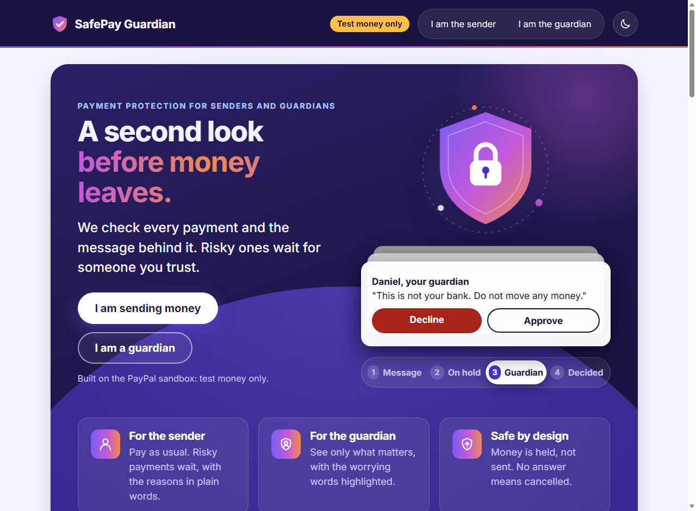

**Jump to:** [The problem](#the-problem) · [What it does](#what-it-does) · [Screenshots](#screenshots) · [Try it in two minutes](#try-it-in-two-minutes-no-keys-needed) · [How it works](#how-it-works) · [PayPal integration](#paypal-integration) · [AI: tools and how they are used](#ai-tools-and-how-they-are-used) · [Evaluation](#evaluation) · [Tests](#tests-and-verification) · [Honest limits](#honest-limits)

---

## The problem

Scammers pretend to be a bank, the government, a grandchild or a friend, and they push people to pay *fast*: gift cards, a "safe account", a wire. Banks and payment apps usually look only at the transaction. By then the person has already been talked into it, and the message that did the talking is nowhere in the picture.

## What it does

SafePay Guardian puts a calm pause and a trusted second opinion between the sender and the money, using PayPal's **authorize, then capture or void** flow. Every payment is *reserved* first and only *taken* once it is cleared.

| Risk | What happens | Who decides |
|---|---|---|
| **Low** | Sent right away. Nothing changes for everyday payments. | Nobody. Rules and AI agree it is normal. |
| **Medium** | The sender sees the reasons and the exact words that worried us, then confirms or cancels. | The sender |
| **High** | **On hold.** The authorization stays open, the guardian is asked, and they chat with the sender in the app. | The guardian: approve (capture) or decline (void) |

If nobody answers before the hold runs out, the payment is **cancelled, never sent**. (If the AI check did not run, a Low payment to a new payee, or for a much larger amount than usual, still asks the sender to confirm.)

It is built for two people:

- **The sender** (large text, plain words): often an older adult. Pays as usual, sees *why* something looks risky, never has to argue with a scammer.
- **The guardian** (a son, daughter, friend or carer): hears only about the payments that matter, sees the evidence, asks a question, and decides.

### Three layers of protection

| Layer | What we look at |
|---|---|
| **Communication** | The pasted message or a screenshot of the conversation, read by safety rules and by Gemini. An AI reason is kept only if it quotes the message word for word. |
| **Transaction** | A new payee, an amount far above the sender's usual, a payee with no explanation. |
| **Payment** | PayPal authorization first. Capture only after a human or a Low result. Void on decline, cancel or silence. |

---

## Screenshots

All captured from the running app in demo mode (made-up people and made-up scam texts).

### The sender

<table>
<tr>
<td width="50%"><b>On hold: the reasons, in plain words, with the suspicious words highlighted.</b> The screenshot the sender uploaded is kept next to the text the AI read from it.<br><br>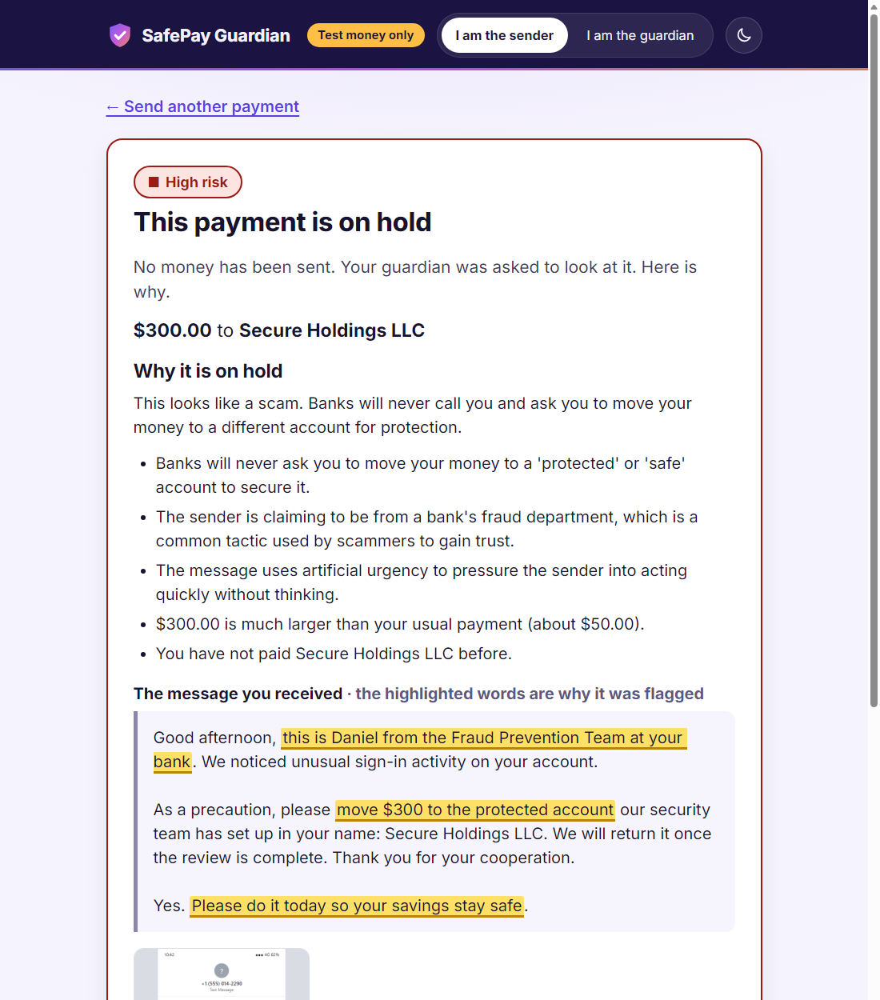</td>
<td width="50%"><b>Medium risk: a warning to confirm or cancel.</b> A legitimate but unusual payment (a $350 deposit to a new contractor) is not blocked, only double-checked.<br><br>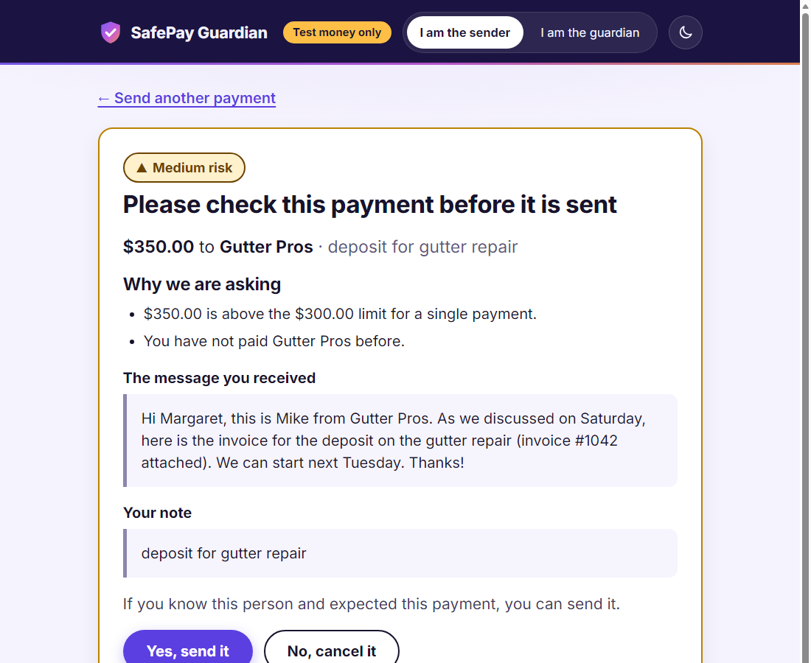</td>
</tr>
</table>

### The guardian

<table>
<tr>
<td width="50%"><b>Review:</b> risk level, the evidence labelled <i>Rule</i> or <i>AI</i> with the quoted words, the matched scam pattern, the payee's history, a hold timer, and Approve or Decline with a note to the sender.<br><br>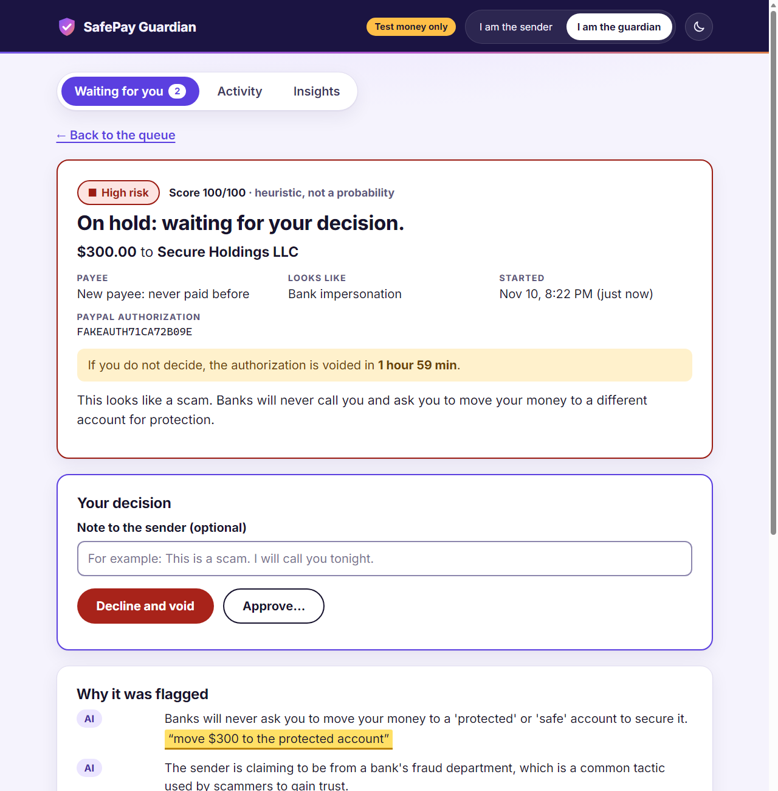</td>
<td width="50%"><b>Queue:</b> pending payments, newest first, with the risk level, payee, amount and how long is left.<br><br>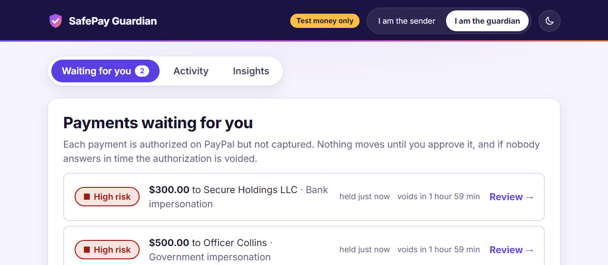<br><br><b>Phone width:</b> every screen works at 400 px.<br><br>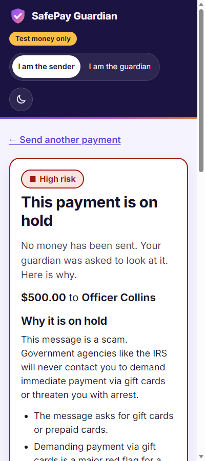</td>
</tr>
</table>

### Activity and Insights (AG Grid and AG Charts, Community editions)

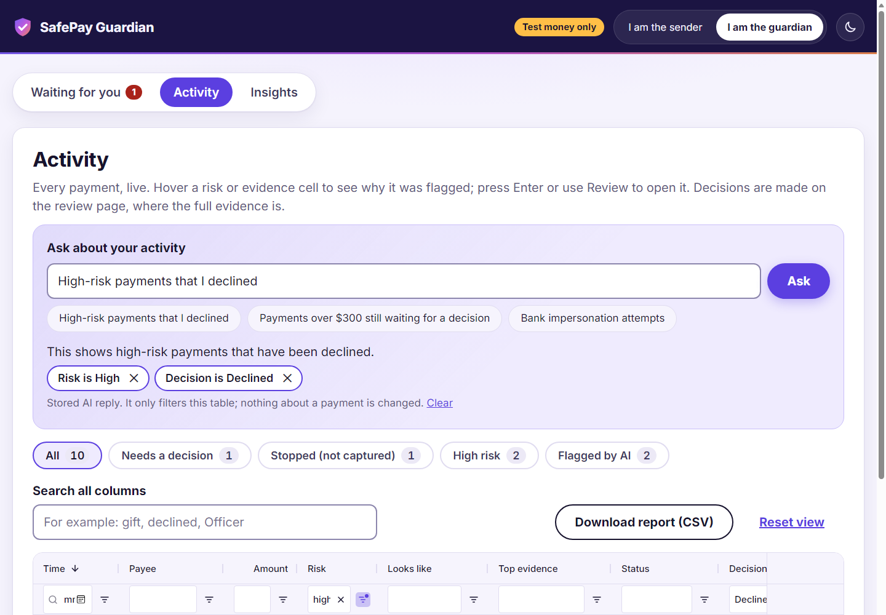

*"Ask about your activity": a plain-English question becomes filter chips that are validated against known columns before they touch the grid. It only filters the view and can never approve or decline anything.*

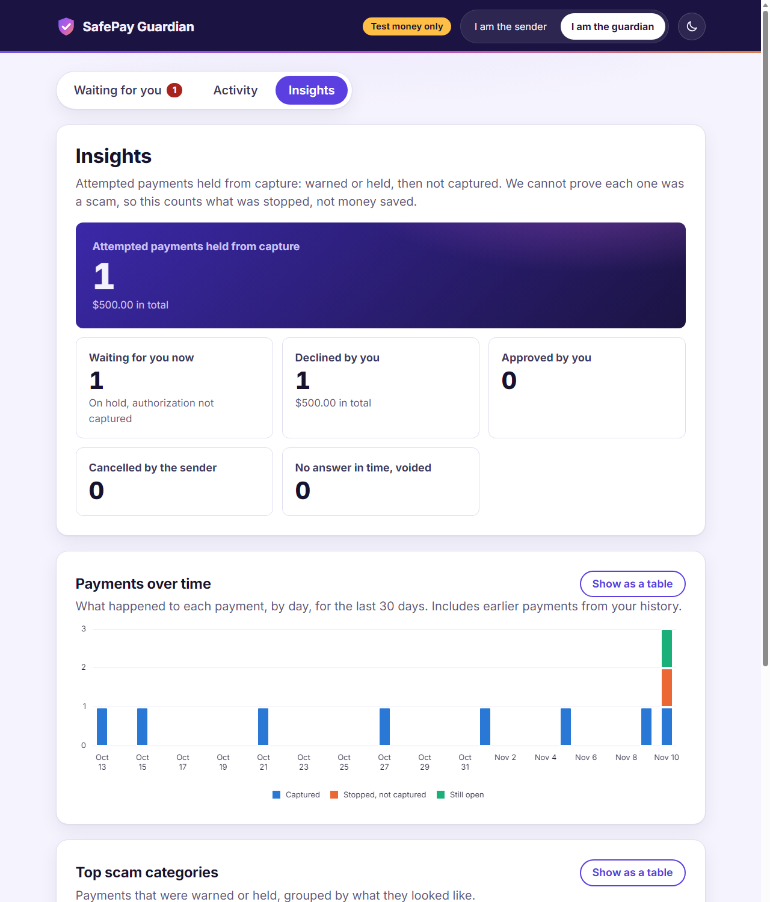

### Home page and themes

Light and dark mode on every screen (it follows the device, with a toggle). The hero is animated: the shield follows the cursor and a looping story shows a scam payment going on hold. "Reduce motion" in the device settings turns all movement off, and touch screens skip the cursor effects.

<table>
<tr>
<td width="50%">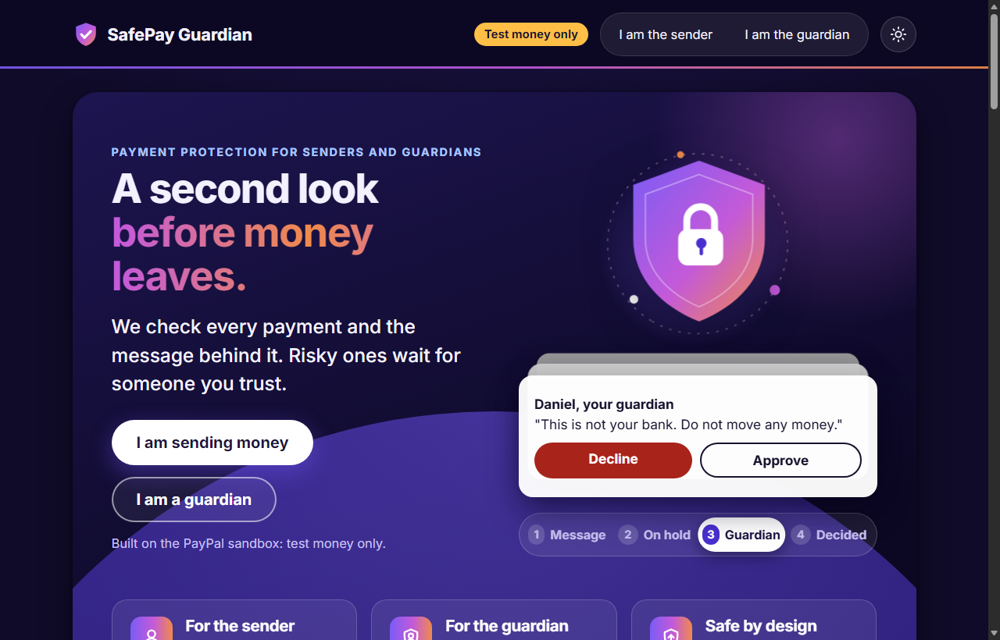</td>
<td width="50%">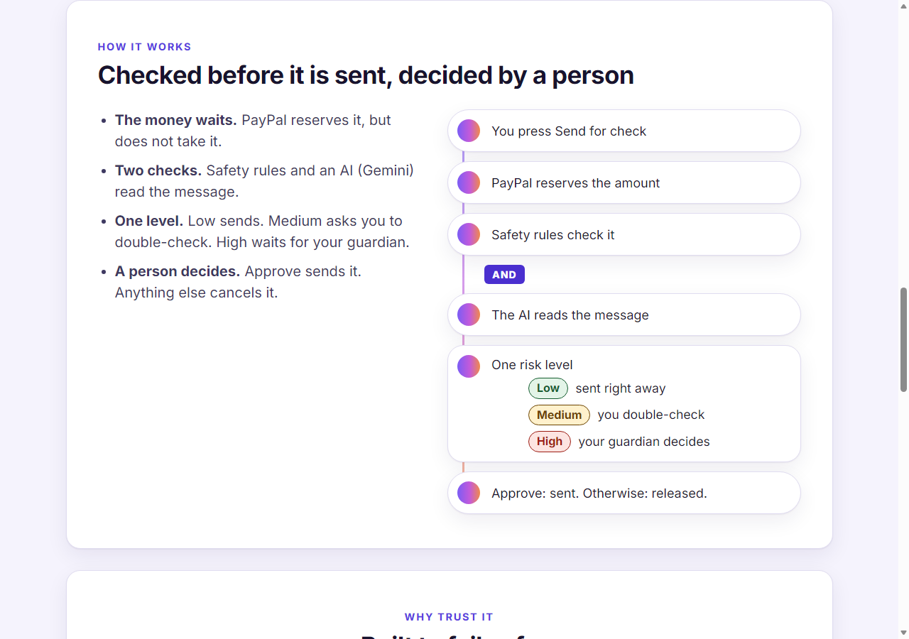</td>
</tr>
</table>

---

## Try it in two minutes (no keys needed)

Judge mode uses a **fake PayPal** and **stored AI replies** for the three demo messages, so it needs no credentials. You need **Python 3.10+** and **Node 22 or 24** (the build tools need Node 20.19+ or 22.12+; it is tested on Node 24). The internet is needed only to install the dependencies; after that it runs offline.

**Windows (PowerShell)**

```powershell
python -m venv .venv
.\.venv\Scripts\python -m pip install -r backend\requirements.txt

# Terminal 1: the backend
cd backend
$env:PAYPAL_MODE="fake"; $env:AI_PROVIDER="replay"; $env:AI_CACHE_DIR="demo/ai-cache"; $env:DATABASE_PATH="data/judge.db"
..\.venv\Scripts\python -m uvicorn app.main:create_app --factory --port 8000

# Terminal 2, from the repo root: seed the demo history, then start the web app
$env:PAYPAL_MODE="fake"; $env:DATABASE_PATH="data/judge.db"
.\.venv\Scripts\python scripts\reset_demo.py
cd frontend; npm install; npm run dev
```

**macOS / Linux, or Git Bash on Windows**

```bash
python3 -m venv .venv
.venv/bin/python -m pip install -r backend/requirements.txt     # .venv/Scripts/python on Git Bash

# Terminal 1: the backend
cd backend
PAYPAL_MODE=fake AI_PROVIDER=replay AI_CACHE_DIR=demo/ai-cache DATABASE_PATH=data/judge.db \
  ../.venv/bin/python -m uvicorn app.main:create_app --factory --port 8000

# Terminal 2, from the repo root
PAYPAL_MODE=fake DATABASE_PATH=data/judge.db .venv/bin/python scripts/reset_demo.py
cd frontend && npm install && npm run dev
```

Open **http://localhost:5173/#/send**. In judge mode the send page shows **Demo mode** buttons: click a scenario, press *Send for check*, then switch to *I am the guardian* in the header to decide. Play them **in order, 1, 2, 3**, right after the reset step.

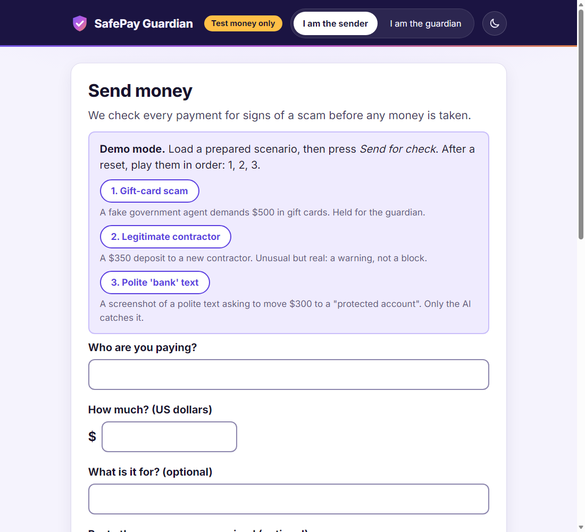

The three scenarios are an obvious scam, a legitimate but unusual payment, and a polite "bank" text that only the AI catches. They are described step by step in [demo/README.md](demo/README.md).

<details>
<summary><b>Troubleshooting: a port is busy, or a command is not found</b></summary>

- **Port 8000 or 5173 is already in use.** Start the backend on another port (for example `--port 8001`), then tell the web app where it is before `npm run dev`: PowerShell `$env:SAFEPAY_BACKEND="http://localhost:8001"`, Bash `SAFEPAY_BACKEND=http://localhost:8001 npm run dev`. The web app prints the address it chose; open that one.
- **`python` is not found on Windows.** Try `py -3.10 -m venv .venv` (or any Python 3.10+), then use `.\.venv\Scripts\python` as shown.
- **PowerShell blocks scripts.** Nothing here needs script execution; the commands call `python` and `npm` directly.
- **The page says "Something went wrong".** Reload. If you edited code while the dev server was running, stop it with Ctrl+C and run `npm run dev` again.
</details>

> **Start over any time** by running the reset step again. The fake PayPal lives in memory, so if you restart the backend, reset too: a payment left open before a restart cannot be completed afterwards.

> Messages other than the three demo ones are checked by the **rules alone**, and the screen says so ("AI check unavailable, rules only"). In that state a payment to a *new* payee, or for a much larger amount than usual, still asks the sender to confirm, even if the rules call it Low.

<details>
<summary><b>Run it on the real PayPal sandbox and Gemini</b></summary>

Copy `.env.example` to `.env` and fill in a PayPal **sandbox** app's client id and secret, a sandbox test card, and a Gemini API key. Then start the backend with no overrides:

```bash
cd backend
../.venv/Scripts/python -m uvicorn app.main:create_app --factory --port 8000
```

Check the connection and the whole flow:

```bash
.venv/Scripts/python scripts/sandbox_gate.py     # raw PayPal calls: create, authorize, capture, void
# start the backend with a short hold first, then:
HOLD_TIMEOUT_SECONDS=20 SWEEPER_INTERVAL_SECONDS=2 DATABASE_PATH=data/smoke.db \
  .venv/Scripts/python -m uvicorn app.main:create_app --factory --port 8000   # from backend/
.venv/Scripts/python scripts/api_smoke.py        # every lane, then reads each authorization back from PayPal
```

The app refuses to start in sandbox mode unless the PayPal address is a PayPal sandbox host. `.env` is git-ignored and is never read by the tests.
</details>

---

## How it works

### Architecture

The browser only ever talks to our backend. The backend is the only thing that talks to PayPal and to the AI.

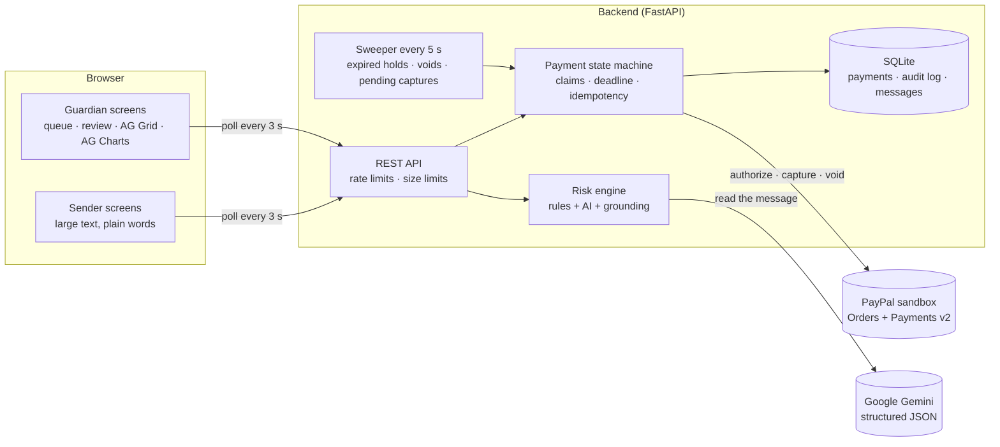

### A scam payment, end to end

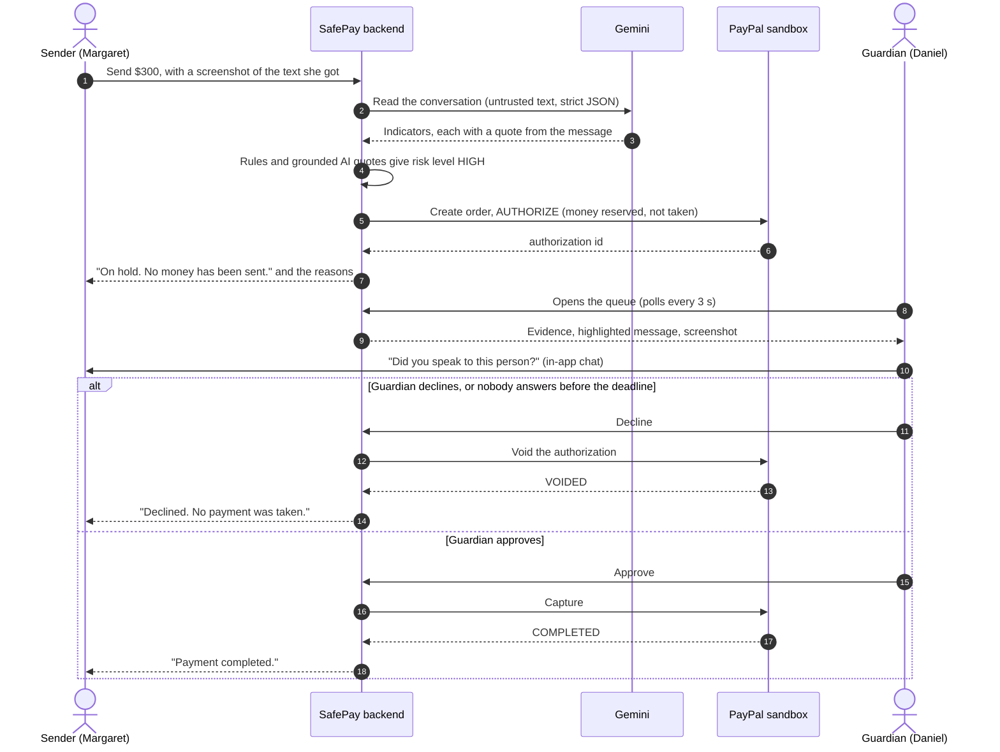

### The payment state machine

Every transition happens inside one SQLite write transaction that *claims* the payment before PayPal is called, so two decisions can never both act.

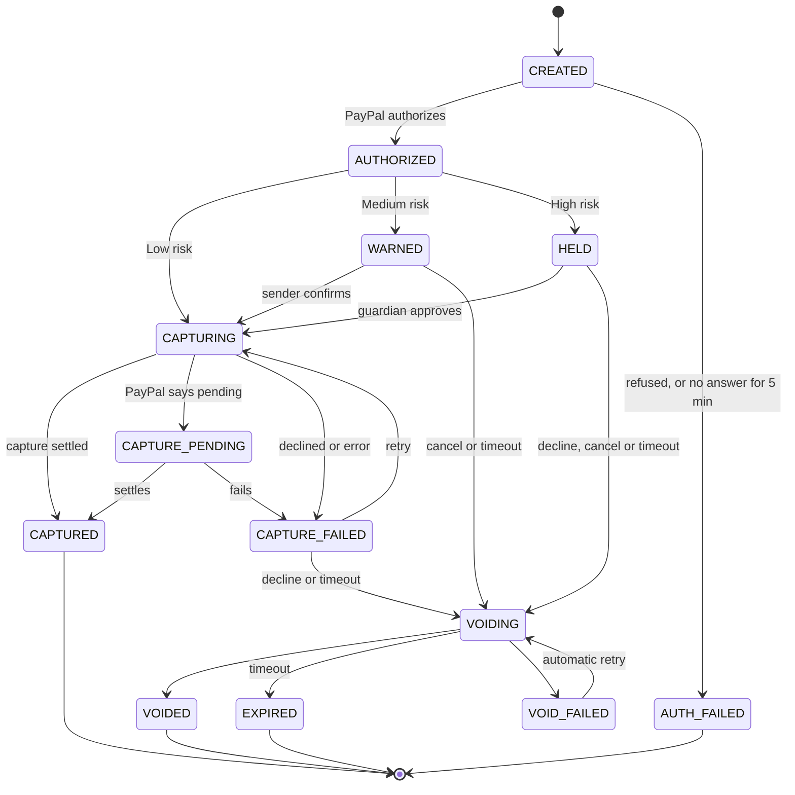

### The risk engine

The AI is never the sole decision-maker. Rules set a floor, the AI adds context, and a person decides what is held.

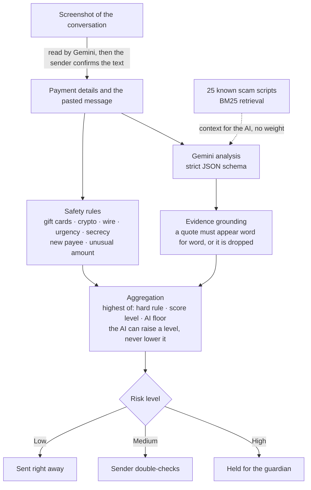

- **Rules** (`backend/app/risk/rules.py`): gift or prepaid cards, crypto, wire or "safe account" requests are hard rules (High on their own). Urgency, secrecy, authority threats, a new payee, an unusual amount and a "new phone number" story add weights.
- **AI** (`backend/app/risk/ai.py`): one call with a strict JSON schema returns a category, indicators with quoted evidence and a recommended action. The message sits inside a delimiter derived from its own hash, so it cannot close it, and instructions inside it are reported as manipulation.
- **Grounding:** every quote the AI returns must literally appear in the message, note, payee or amount. Anything else is dropped and logged, never shown.
- **Degraded mode:** if the AI is unavailable, times out (12 s) or returns bad JSON, the engine runs on rules alone and says so. Hard rules still hold dangerous payments.
- The risk level is a **heuristic decision aid, not a fraud probability**. Every number lives in `backend/app/risk/config.py`.

---

## PayPal integration

PayPal is central, not decoration: the whole product *is* the authorize, capture and void flow.

| Step | PayPal call | Why |
|---|---|---|
| Reserve | Orders v2 `POST /v2/checkout/orders` with `intent: AUTHORIZE` and the sandbox test card | Reserves the amount without taking it. This is the hold. |
| Check | `GET /v2/payments/authorizations/{id}` before every capture and void | If PayPal already shows it captured, voided or expired, we record that instead of calling again. |
| Approve | `POST .../authorizations/{id}/capture` | Takes the money, only after a Low result or a human decision. |
| Decline, cancel, silence | `POST .../authorizations/{id}/void` | Releases the reservation. Nothing is taken. |
| Settle | `GET /v2/payments/captures/{id}` | A capture PayPal calls pending is re-checked until it settles. |

Every call carries a deterministic `PayPal-Request-Id` (`{payment_id}-{action}-{attempt}`): network retries reuse it, so a lost response can never cause a second capture, and only a definite refusal moves to the next attempt number.

### Safety guarantees (each one has tests)

- **Nothing is captured until a decision.** A claim moves the payment to `CAPTURING` or `VOIDING` before any PayPal call; a repeat in the same direction returns the first result and the opposite direction gets a plain 409.
- **A payment is "completed" only when PayPal reports the capture as settled.** Pending is shown as "PayPal is still confirming it".
- **The hold deadline is checked inside the decision itself**, not only by the background sweeper: an approval that arrives after it cannot capture.
- **An authorization PayPal never answered is not treated as failed.** It may have gone through, so it is retried with the same request id.
- **Pressing Send twice cannot make two payments.** The form sends a submission key and the server returns the first payment for it.
- **Silence fails safe.** Warned and held payments are voided when the hold times out (24 hours; 2 minutes in the demo).
- **The audit log** records every state change and the main PayPal steps, with PayPal's debug ids, and never a card number or token.
- **Sandbox only, checked.** In sandbox mode the app refuses to start unless the PayPal address is a PayPal sandbox host.

*In production this would use PayPal Checkout with payer approval and webhooks (with signature verification) instead of polling our own backend.*

---

## AI: tools and how they are used

All AI is **Google Gemini 3.1 Flash-Lite**, called from the backend over its REST API with a structured-JSON schema, at temperature 0, behind a small provider interface (so the model can be swapped). The key never leaves the server.

| Use | What the AI does | What it can never do |
|---|---|---|
| **Risk check** | Reads the message and returns a category and indicators with quoted evidence. | Approve, decline or move money, or lower a risk level. |
| **Screenshot reading** | Copies each received message word for word, skips the sender's own replies. The sender confirms the text before anything is checked. | Follow instructions written inside the image. |
| **Ask about your activity** | Turns a plain-English question into filter chips. A validator keeps only known columns, operators and values. | Change a payment. It is read-only. |

Stored replies (`demo/ai-cache/`) let judges run the demo with no key and let the video avoid free-tier limits. Anything not stored falls back to rules only, visibly.

---

## Evaluation

Two sets, reported separately and honestly. The engine was **tuned once on the 16-case development set and then frozen**; the held-out set was written afterwards and never used for tuning, even where the numbers dropped.

| Held-out set: 69 cases | Rules only | AI only | **Hybrid** |
|---|---|---|---|
| Scams held for the guardian (High) | 22/46 (48%) | 44/46 (96%) | **44/46 (96%)** |
| Scams at least warned (Medium or High) | 36/46 (78%) | 46/46 (100%) | **46/46 (100%)** |
| Everyday payments wrongly held | 0 of 17 | 0 of 17 | **0 of 17** |
| Level accuracy | 47/69 (68%) | 67/69 (97%) | **68/69 (99%)** |

The 16-case development set: hybrid 16/16, rules only 12/16, AI only 15/16, identical across 3 runs.

The held-out set has 30 scams written from patterns published by the FTC and the FBI (each case cites its source page), 14 everyday payments, 6 ambiguous cases, 8 adversarial cases (disguised words, Spanish, lookalike letters, attempts to instruct the AI) and **11 real text messages** from a public research dataset.

> **Read these numbers carefully.** They were measured with a 30-second AI timeout and generous retries. The app waits 12 seconds and then falls back to rules only: in this run 6 of 69 replies were slower than that. It is a small, mostly self-written set, **not a measured real-world fraud rate**. That gap is exactly why a payment the rules call Low still needs the sender's OK when the AI did not run and the payee is new or the amount is unusual.

Full tables and every case: [eval/results.md](eval/results.md) and [eval/results_heldout.md](eval/results_heldout.md).

```bash
.venv/Scripts/python eval/run_eval.py --cached                  # offline, from the committed AI replies
.venv/Scripts/python eval/run_eval.py --cases eval/heldout_cases.json --out results_heldout --cached
```

---

## Tests and verification

| What | Command | Result |
|---|---|---|
| Backend: state machine, PayPal client, risk engine, hardening | `cd backend && ../.venv/Scripts/python -m pytest -q` | **206 passing**, offline |
| Frontend: unit tests | `cd frontend && npm test` | **75 passing** |
| Frontend: type-check and production build | `npm run build` | clean |
| Frontend: lint | `npx oxlint src` | clean |
| Real PayPal sandbox, every lane | `scripts/api_smoke.py` | every lane passed; each authorization read back from PayPal (CAPTURED or VOIDED as expected) |
| Three demo scenarios, three runs plus one standalone | `scripts/demo_rehearsal.py --runs 3 --standalone 3` | all passed; every authorization matched PayPal |

The safety tests run against an in-process fake PayPal with fault injection (lost responses, timeouts, pending captures, an authorization voided behind our back, concurrent approve and cancel). Each fix has a test that **fails when the fix is switched off**. Dated results, screenshots and what each run found: [test-runs/LOG.md](test-runs/LOG.md).

---

## Built with

| | |
|---|---|
| **Backend** | Python 3.10+, FastAPI, SQLite (parameterised SQL only), httpx |
| **Frontend** | React, TypeScript, Vite, Inter font bundled for offline use |
| **Guardian tools** | [AG Grid Community](https://www.ag-grid.com/) (Activity case log, status flashes, preset views, totals row, CSV export) and AG Charts Community (Insights) |
| **AI** | Google Gemini 3.1 Flash-Lite, structured JSON |
| **Payments** | PayPal Orders v2 and Payments v2, sandbox |

### Project layout

```text
backend/app/   state.py (state machine)  paypal.py (real + fake PayPal)  risk/ (rules, AI, grounding, patterns)
               main.py (API)  db.py  ratelimit.py  activity_query.py  demo.py
backend/tests/ 206 tests          frontend/src/  sender/  guardian/  home/  (React screens)
eval/          cases, held-out cases, runner, results, stored AI replies
demo/          scenarios.json, runbook, stored AI replies, the made-up screenshot
scripts/       sandbox_gate  api_smoke  demo_rehearsal  reset_demo
docs/          BUILD_PLAN.md  HANDOFF.md  images/       test-runs/   dated test log and screenshots
```

<details>
<summary><b>API reference</b></summary>

| Method and path | What it does |
|---|---|
| `POST /payments` | Create a payment, run the risk engine, authorize on PayPal, then capture, warn or hold. Send an `Idempotency-Key` header to make a retry safe. |
| `GET /payments` | List payments (`?status=HELD,WARNED`, `?queue=guardian`) |
| `GET /payments/{id}` | One payment with risk assessment, audit events and messages |
| `POST /payments/{id}/confirm` | Sender confirms a warning (captures) |
| `POST /payments/{id}/cancel` | Sender cancels a warned or held payment (voids) |
| `POST /payments/{id}/approve` | Guardian approves a held payment (captures, idempotent) |
| `POST /payments/{id}/decline` | Guardian declines a held payment (voids, idempotent) |
| `POST /payments/{id}/retry` | Guardian retries a failed capture or void |
| `POST /payments/{id}/messages` | Add a sender or guardian message |
| `GET /stats` | Counts and totals for Insights |
| `POST /screenshots` · `GET /screenshots/{id}` | Save and transcribe a screenshot; fetch it back |
| `POST /activity/ask` | Plain-English question to validated grid filters (read-only) |
| `POST /assess` | Run the risk engine on a message without creating a payment |
| `GET /health` | PayPal and AI configuration and reachability |
</details>

<details>
<summary><b>Security notes</b></summary>

- **Secrets stay on the server.** PayPal credentials, the sandbox card and the Gemini key are read from `.env` (git-ignored) as secret values and are never returned by the API or written to the audit log. The Gemini key is sent in a header, not the URL.
- **Scam text is treated as hostile.** The message goes to the AI inside a delimiter the scammer cannot predict; AI evidence is kept only if it appears word for word in what the sender received; "Ask about your activity" can only produce filters checked against known columns and values.
- **Inputs are bounded.** Amounts, text lengths and list sizes are validated; request bodies over 8 MB get a 413; screenshots must be real PNG, JPEG or WebP files under 4 MB and are stored under a content fingerprint.
- **Rate limits per visitor** on endpoints that create things or call the AI (per minute: 20 payments, 10 screenshots, 20 AI checks, 30 messages), with a plain "please wait N seconds" message.
- **The CSV report is safe to open in a spreadsheet:** cells that start like a formula are written as text.
- `npm audit` and `pip-audit` reported no known vulnerabilities on Nov 10, 2026.
</details>

---

## Honest limits

This is a hackathon prototype of a protection *workflow*, not a certified fraud-prevention product.

- **There is no real login.** A toggle switches between the sender and guardian views, and the API trusts whoever calls it. A real deployment needs sender and guardian accounts, an invitation the sender approves (and can revoke) to link a guardian, and server-side checks that only the linked guardian can decide. Until then, run it locally or host only the no-keys demo.
- **Payees are labels.** In the sandbox every payment settles to one merchant account. With real recipients, trust must attach to a verified account, not a typed name.
- **The amount limit is a risk signal, not a cap.** There are no enforced daily limits and no check for a large payment split into small ones.
- **Screenshots are sent to Google Gemini** to be read, and are kept on the server. Use made-up conversations in demos.
- **Guardians are not notified.** They see a held payment when they open the app (it polls every 3 seconds); there is no email, push or text yet.
- **Polling, not webhooks, and one server process.** Production would use PayPal Checkout with payer approval, signed webhooks and more than one worker.
- **The rules and the AI can both be wrong** in ways the evaluation does not cover, for example a hard keyword rule firing on a sentence that warns *against* a scam.

### Where it goes next

Sender-approved guardian invitations with revocation, real notifications to the guardian, verified payees, enforced spending limits, PayPal webhooks, and a study with older adults and their caregivers to learn whether "on hold" is understood.

---

## Credits and license

MIT License, Copyright (c) 2026 Himani Agrawal. See [LICENSE](LICENSE).

- Real text messages in the held-out set: Mishra, S. & Soni, D. (2022). *SMS Phishing Dataset for Machine Learning and Pattern Recognition*. Mendeley Data, v1. [doi:10.17632/f45bkkt8pr.1](https://doi.org/10.17632/f45bkkt8pr.1), licensed [CC BY 4.0](https://creativecommons.org/licenses/by/4.0/). Copied verbatim except for repairing encoding damage.
- The other held-out cases and the 25 scam scripts are written in our own words from scam patterns published by the FTC, the FBI IC3 and AARP. The demo people, businesses and messages are made up.
- Inter font (SIL Open Font License) via `@fontsource-variable/inter`. AG Grid and AG Charts Community editions.
- Design direction for the home page was inspired by a Dribbble motion concept; shapes and copy are our own.
